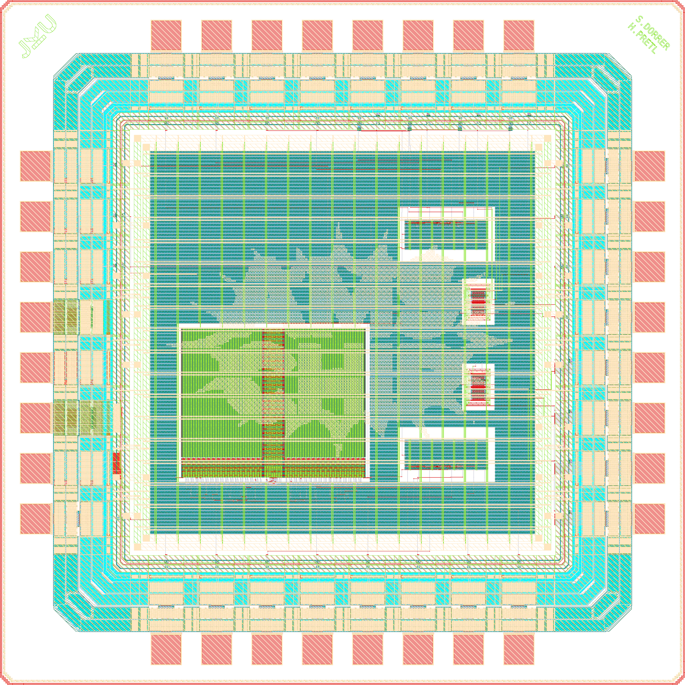

# SoC1693 Datasheet

SoC1693 is the demonstrator chip of the open-source analog mixed-signal chip template for the IHP SG13CMOS5L Open-PDK. It shows every element of the template flow on one die: two LibreLane-hardened digital counters, two hand-drawn CMOS inverter macros used as digital and as analog blocks, a 1024 x 32 bit SRAM, an IHP IO pad ring with analog pads, logos and the seal ring. The design source is [iic-jku/ihp-sg13cmos5l-ams-chip-template](https://github.com/iic-jku/ihp-sg13cmos5l-ams-chip-template), see [SoC1693-main/README.md](../SoC1693-main/README.md).

(c) 2026 Simon Dorrer and Harald Pretl, Institute for Integrated Circuits and Quantum Computing, Johannes Kepler University (JKU), Linz, Austria.

## Key Data

| Parameter | Value |
| --- | --- |
| Technology | IHP SG13CMOS5L, 130 nm CMOS, Metal1 to Metal4 plus TopMetal1 |
| Die size | 1.6 mm x 1.6 mm (2.56 mm²), seal ring included |
| Core area | 0.87 mm x 0.87 mm |
| Core supply `VDD` | 1.5 V |
| IO supply `IOVDD` | 3.3 V |
| Clock | `clk_PAD`, 50 MHz target (20 ns period) |
| Reset | `rst_n_PAD`, active low, synchronous |
| Pads | 32 (8 per side): 4 supply, 3 control inputs, 17 digital outputs, 4 bidirectional, 4 analog |
| Package | QFN32, 5 mm x 5 mm, 0.5 mm pitch |
| Timing corners | 1.08 V to 1.65 V, -40 °C to 125 °C (six STA corners, see [Specification.md](Specification.md)) |

## Function

- **Global enable** (`input_PAD[0]`): with `enable = 1` both counters count and the four bidirectional pads drive `counter1[7:4]`. With `enable = 0` the counters hold and the bidirectional pads are inputs that feed the inputs of `inverter1`.
- **Counters** (`counter1`, `counter2`): two 8-bit synchronous up-counters that wrap from 255 to 0. `counter1[3:0]` drives `output_PAD[3:0]`, `counter1[7:4]` drives `bidir_PAD[3:0]`, and `counter2[7:0]` drives `output_PAD[11:4]`.
- **Digital inverter** (`inverter1`): four CMOS inverters from `bidir_PAD[3:0]` to `output_PAD[15:12]`.
- **Analog inverter** (`inverter2`): two channels on the analog pads. The inputs reach the inverters through the pad's series ESD resistor (`padres`), the outputs leave through the direct pad connection (`padbare`). Channels 3 and 4 are tied to `VSS`.
- **SRAM**: a 1024 x 32 bit single-port SRAM that reads address 0 on every clock edge. The XOR of its 32 output bits drives `output_PAD[16]`. Writes and BIST are disabled.

## Pinout

Package pins are numbered counter-clockwise from pin 1. The bond plan is [SoC1693_bondplan_white.png](../release/v.1.0.0/doc/img/SoC1693_bondplan_white.png) and its full bond table is [packaging/result.md](https://github.com/iic-jku/ihp-sg13cmos5l-ams-chip-template/blob/60166ac618be6cc312253b7fed33f8478d044a55/packaging/result.md).

| Pin | Pad | Type | Function |
| --- | --- | --- | --- |
| 1 | `clk_PAD` | digital in | clock |
| 2 | `rst_n_PAD` | digital in | active-low reset |
| 3 | `input_PAD[0]` | digital in | global enable |
| 4 | `IOVDD` | supply | 3.3 V IO supply |
| 5 | `IOVSS` | ground | IO ground |
| 6 | `VDD` | supply | 1.5 V core supply |
| 7 | `VSS` | ground | core ground |
| 8 | `output_PAD[16]` | digital out | XOR of the SRAM output word |
| 9 to 16 | `output_PAD[4]` to `output_PAD[11]` | digital out | `counter2[0]` to `counter2[7]` |
| 17 | `analog_PAD[0]` | analog in | `inverter2` channel 1 input (`padres`) |
| 18 | `analog_PAD[1]` | analog in | `inverter2` channel 2 input (`padres`) |
| 19 | `analog_PAD[2]` | analog out | `inverter2` channel 1 output (`padbare`) |
| 20 | `analog_PAD[3]` | analog out | `inverter2` channel 2 output (`padbare`) |
| 21 to 24 | `output_PAD[12]` to `output_PAD[15]` | digital out | `inverter1` outputs 1 to 4 |
| 25 to 28 | `bidir_PAD[3]` to `bidir_PAD[0]` | digital bidir | `counter1[7]` to `counter1[4]` when `enable = 1`, `inverter1` inputs 4 to 1 when `enable = 0` |
| 29 to 32 | `output_PAD[3]` to `output_PAD[0]` | digital out | `counter1[3]` to `counter1[0]` |

## Operating Notes

- Digital pads use the 3.3 V IO cells of `sg13cmos5l_io`. Logic levels at the pads follow `IOVDD`.
- IHP characterizes the SRAM up to 1.32 V. At the 1.5 V core supply its timing in the analysis comes from the 1.32 V, -55 °C model, see [Specification.md](Specification.md).
